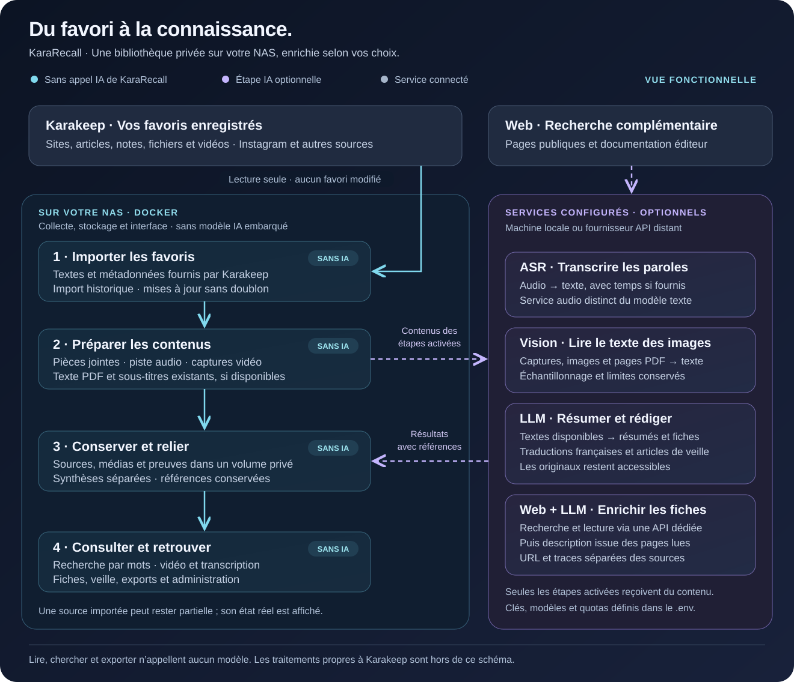

<p align="center">
  
</p>

<h1 align="center">KaraRecall</h1>

<p align="center">
  <strong>Retrouvez vos découvertes. Comprenez ce qu’elles apportent. Gardez le fil.</strong><br />
  Votre bibliothèque personnelle à partir de tous vos favoris Karakeep.
</p>

<p align="center">
  Auto-hébergé sur NAS · Docker Compose · Interface et synthèses en français · IA configurable
</p>

<p align="center">
  <a href="docs/INSTALLATION.md">Installer</a> ·
  <a href="#comment-ça-fonctionne">Comprendre le fonctionnement</a> ·
  <a href="docs/IMAGES-DOCKER.md">Mettre à jour</a> ·
  <a href="#documentation">Documentation</a> ·
  <a href="backlog.md">Backlog</a>
</p>

<p align="center">
  <a href="https://github.com/Nello10110/kararecall/actions/workflows/ci.yml"></a>
</p>

## Vos favoris deviennent une bibliothèque exploitable

Un article à relire, un outil aperçu dans une vidéo, un site à tester : Karakeep les enregistre ; KaraRecall permet de les retrouver, de comprendre leur intérêt et de repartir de leurs sources.

L’application conserve une bibliothèque privée sur votre NAS. Les traitements IA configurés peuvent y ajouter des résumés courts en français, des traductions, les paroles des vidéos et le texte visible à l’écran. La consultation reste disponible lorsque les modèles sont indisponibles.

**Tous les favoris sont inclus par défaut** : sites, articles, notes, fichiers, PDF, images et vidéos, dont les reels Instagram. Karakeep reste une source en lecture seule : KaraRecall ne modifie, ne tague et ne supprime aucun favori.

| Pour… | KaraRecall propose… |
| --- | --- |
| **Retrouver une découverte** | Une recherche dans les titres, textes, résumés, transcriptions et textes reconnus dans les images. |
| **Comprendre un outil** | Une fiche avec description, utilité, fonctionnement, limites et liens pour approfondir, accompagnée de ses références. |
| **Revenir au bon passage** | La vidéo et sa transcription côte à côte, des passages cliquables, des captures horodatées et des références par page pour les PDF. |
| **Faire de la veille** | Des articles illustrés hebdomadaires et mensuels, consultables dans l’application ; mail, RSS privé et webhook selon la configuration. |
| **Poursuivre avec un assistant** | Des exports Markdown, un contexte sourcé à copier et un adaptateur MCP en lecture seule. |
| **Garder la main** | Un tableau de bord, le suivi des traitements, les quotas IA, les diagnostics et les commandes de pause et de reprise. |

L’interface glass propose un thème sombre et un thème clair, avec une navigation adaptée au mobile. [Découvrir les écrans et leur rôle](docs/UX-ET-ADMINISTRATION.md).

## Comment ça fonctionne



1. **Importer.** Le worker lit Karakeep et récupère les textes et métadonnées. L’import de tout l’historique est disponible dans l’interface et ne crée pas de doublons pour un même identifiant Karakeep.
2. **Préparer.** Lors des traitements, les pièces jointes sont téléchargées et préparées localement : extraction du son, captures vidéo, texte incorporé aux PDF et sous-titres existants.
3. **Enrichir, si configuré.** Les services audio, vision et texte produisent les extractions et synthèses demandées. Une recherche web optionnelle complète les fiches à partir de pages lues, avec leurs URL et leurs traces.
4. **Conserver et consulter.** Sources, médias, preuves et synthèses restent dans le volume privé. Vous recherchez, consultez, relisez et exportez les résultats depuis le navigateur.

**Bleu : aucun appel IA de KaraRecall. Violet : traitement IA optionnel.** Les services IA sont hébergés séparément, sur une machine locale ou chez un fournisseur API. Aucun serveur de modèles n’est installé par le Compose.

[Lire le schéma pas à pas](docs/ARCHITECTURE-FONCTIONNELLE.md) · [Ouvrir le schéma en grand](docs/assets/architecture-fonctionnelle.svg) · [Architecture technique](docs/ARCHITECTURE.md)

### Où intervient l’IA ?

| Étape | Utilisation de l’IA dans KaraRecall |
| --- | --- |
| Import du catalogue et dédoublonnage | **Aucune.** L’import historique ne télécharge pas les médias et ne lance aucune analyse IA. |
| Téléchargement et préparation des médias | **Aucune.** Extraire le son, créer des captures, lire le texte incorporé aux PDF ou réutiliser des sous-titres ne demande pas de modèle. |
| Reconnaissance de nouvelles paroles | **Oui, si activée.** Un moteur audio spécialisé (ASR, par exemple Whisper) transforme le son en texte. |
| Lecture du texte dans les images | **Oui, si activée.** Un modèle vision lit les captures, images ou aperçus de pages PDF. |
| Résumés, traductions et fiches | **Oui, si activés.** Le modèle texte rédige à partir des contenus disponibles et de leurs références. |
| Enrichissement web des outils | **Services de recherche/lecture + LLM.** Les pages sont obtenues via une API dédiée ; le LLM rédige le complément à partir des pages lues. |
| Bulletins de veille | **IA pour la rédaction automatique.** Sélection, mise en page, exports et diffusion sont des opérations applicatives. |
| Recherche dans votre bibliothèque, consultation et exports | **Aucune.** Ces actions utilisent les contenus déjà conservés et ne relancent pas les modèles. |

La recherche actuelle est **lexicale** : elle normalise les accents et tolère certaines fautes. Elle ne comporte pas encore de recherche sémantique ni d’embeddings. La rédaction préalable des résumés enrichit les textes recherchables, sans ajouter d’appel LLM à chaque recherche.

Les éventuels traitements IA réalisés par Karakeep lui-même sont indépendants de ceux décrits ici.

## Démarrer sur votre NAS

Prérequis : **Docker Compose v2**, un serveur Karakeep accessible et une clé API Karakeep. Les images publiques sont disponibles pour **Linux AMD64 et ARM64** ; aucun compte GitHub ni build sur le NAS n’est nécessaire pour les télécharger.

```sh
git clone https://github.com/Nello10110/kararecall.git
cd kararecall
python3 scripts/setup_env.py --profile deepseek
```

Complétez les lignes existantes dans le fichier privé `.env` :

```dotenv
KARAKEEP_BASE_URL='https://karakeep.example.net'
KARAKEEP_API_KEY='REMPLACER_PAR_VOTRE_CLE_KARAKEEP'
COMPOSE_PROFILES=automation
KARARECALL_BIND_ADDRESS=0.0.0.0
SYNC_ENABLED=false
LLM_ENABLED=false
KARAKEEP_URL_FILTER=
KARAKEEP_TAG_FILTER=
```

```sh
docker compose up -d
```

Ouvrez **`http://IP_DU_NAS:8765`**, connectez-vous avec les identifiants générés dans `.env`, puis choisissez **Activité → Importer tout l’historique**. Pour un essai uniquement sur le Mac, gardez l’écoute `127.0.0.1` et ouvrez [http://127.0.0.1:8765](http://127.0.0.1:8765).

L’import initial fonctionne sans IA. Activez ensuite les modèles et la synchronisation après un premier essai sur une source. Le profil DeepSeek prépare le texte et la vision ; la transcription audio se configure séparément. Clés, endpoints, modèles et plafonds restent dans votre `.env`.

**[Suivre le manuel d’installation](docs/INSTALLATION.md)** — avec une méthode sans Python sur le NAS, l’activation de DeepSeek et les premiers contrôles. Pour un accès distant, utilisez un VPN ou un reverse proxy HTTPS.

### Des mises à jour avec latest

Le Compose utilise `ghcr.io/nello10110/kararecall-web:latest` et `ghcr.io/nello10110/kararecall-worker:latest`. Les images sont publiées après les tests ; des tags de commit permettent de figer une paire.

```sh
docker compose --profile automation pull web worker
docker compose --profile automation up -d --no-deps web worker
```

`latest` est téléchargé au déploiement : un conteneur déjà lancé ne change pas tout seul. Conservez le volume et votre `.env`. [Guide Docker : Dockhand, Compose existant, versions figées et construction locale](docs/IMAGES-DOCKER.md).

## Vos données et vos réglages restent chez vous

- **Un volume persistant privé** conserve les JSON, médias, preuves, fiches et bulletins. Une installation neuve démarre vide ; aucun favori ni secret n’est livré dans le dépôt ou les images.
- **Des contenus séparés** distinguent texte original, note personnelle, transcription, texte reconnu, traduction, synthèse et vérification externe. Les références et anciennes versions restent disponibles.
- **Des services IA explicites** reçoivent uniquement les contenus correspondant aux étapes configurées : textes, audio ou images. Un endpoint peut être local ou distant ; les appels distants transmettent ces contenus au fournisseur choisi.
- **Des traitements bornés** disposent de cache, reprises et quotas persistants. La consultation fonctionne sans fournisseur IA ; les nouveaux traitements qui en dépendent attendent ou signalent leur échec.

Le volume Docker assure la persistance ; il faut aussi une sauvegarde séparée. [Configuration, réseau et sauvegarde/restauration](docs/HOMELAB.md).

## À connaître avant de commencer

Les résultats IA peuvent comporter des erreurs : une référence valide ne garantit pas une reformulation fidèle. Les fiches automatiques restent à relire. L’interface distingue un favori importé, un résumé produit et une vidéo effectivement transcrite et analysée à l’écran.

Les vidéos sont limitées par défaut à **100 Mio et 5 minutes** ; la vision échantillonne au plus **12 captures**, espacées d’au moins 5 secondes, et peut manquer un texte bref. Un PDF ou une image sans texte exploitable reste signalé comme partiellement traité ou comme métadonnées seules. Les suppressions dans Karakeep ne suppriment pas les copies locales.

Le budget applicatif est réglé par défaut sur **2 USD/mois**. Il s’agit d’un suivi comptable configurable, distinct de la facture fournisseur et des appels propres à Karakeep. La diffusion des bulletins exige la configuration et l’activation du canal choisi. L’application utilise un compte partagé ; elle ne gère pas de rôles multi-utilisateurs.

Le pilote NAS a démarré ; la qualité sur un corpus varié, les coûts réels, les endpoints et la restauration sur le matériel restent à qualifier. [Guide du pilote](docs/PILOTE.md) · [Travaux restants](backlog.md).

## Documentation

| Votre besoin | Guide |
| --- | --- |
| Installer et importer vos premiers favoris | [Manuel d’installation](docs/INSTALLATION.md) |
| Comprendre les grands flux et les rôles IA | [Architecture fonctionnelle](docs/ARCHITECTURE-FONCTIONNELLE.md) |
| Comprendre les composants, contrats et formats | [Architecture technique](docs/ARCHITECTURE.md) |
| Mettre à jour avec `latest`, utiliser Dockhand ou construire localement | [Images Docker](docs/IMAGES-DOCKER.md) |
| Configurer le NAS, le réseau et les sauvegardes | [Guide homelab](docs/HOMELAB.md) |
| Brancher Karakeep, DeepSeek et les moteurs de traitement | [Import et DeepSeek](docs/IMPORT-ET-DEEPSEEK.md) |
| Utiliser les écrans et administrer l’application | [Parcours et administration](docs/UX-ET-ADMINISTRATION.md) · [Interface et API](docs/WEB.md) |
| Configurer les articles et les canaux de diffusion | [Veille hebdomadaire et mensuelle](docs/VEILLE.md) |
| Comprendre la recherche web et ses références | [Enrichissement web](docs/RECHERCHE-WEB.md) |
| Connecter un assistant à la bibliothèque | [MCP en lecture seule](docs/MCP.md) |
| Valider l’installation et mesurer les résultats | [Pilote](docs/PILOTE.md) · [Socle de fiabilité](docs/P0.md) |
| Comprendre les choix, les coûts et les évolutions envisagées | [Étude d’exploitation](docs/ETUDE-EXPLOITATION.md) · [Long terme](docs/EXPLOITATION-LONG-TERME.md) · [Backlog](backlog.md) |

## Développement et validation

Python 3.12 dans les images, une interface HTML/CSS/JavaScript sans compilation, un service web et un worker optionnel. Le Compose limite le web à 384 Mio et le worker à 768 Mio, hors services de modèles.

```sh
PYTHONPYCACHEPREFIX=.build/pycache python3 -m unittest discover -s tests -v
python3 scripts/check_container.py
```

Le test Docker utilise `compose.build.yaml`, construit le code local et supprime ses ressources de test. La CI vérifie également les médias et MCP sur des données synthétiques. Pour développer avec les deux services :

```sh
docker compose -f compose.yaml -f compose.build.yaml up -d --build
```

Les scripts historiques macOS (`scripts/process.py`, transcription locale et OCR Apple Vision) sont distincts du worker Docker. Les JSON, Markdown et preuves restent portables ; SQLite est un stockage dérivé ou opérationnel selon son rôle. AFFiNE et Wiki.js peuvent recevoir des exports manuels, sans connecteur de synchronisation intégré.
