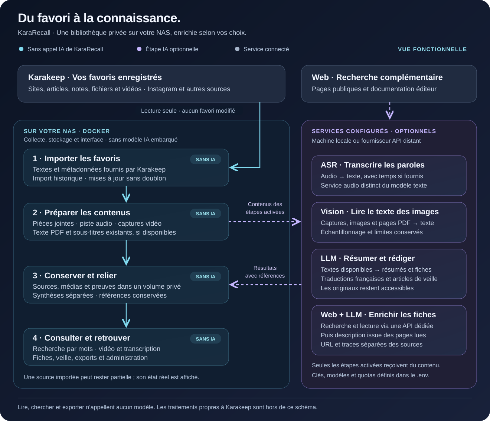

# Architecture fonctionnelle

[🇫🇷 Français](ARCHITECTURE-FONCTIONNELLE.md) · [🇬🇧 English](en/functional-architecture.md)

[Présentation de KaraRecall](../README.md) · [Architecture technique](ARCHITECTURE.md) · [Installation](INSTALLATION.md)

KaraRecall transforme les contenus déjà enregistrés dans Karakeep en une bibliothèque consultable, avec des enrichissements IA facultatifs. Le NAS assure la collecte, la conservation et l’interface ; les services de modèles sont configurés séparément.

[Ouvrir le schéma en grand](assets/architecture-fonctionnelle.svg). Le SVG contient les textes et formes éditables, sans image externe ni police distante. Bleu : aucun appel IA de KaraRecall ; violet : étape IA optionnelle ; gris : service connecté. Les couleurs sont doublées de libellés explicites.

## 1. Importer ce qui a été enregistré

Karakeep est la porte d’entrée : sites, articles, notes, fichiers et vidéos, y compris Instagram. KaraRecall utilise son API en lecture seule et conserve les informations accessibles à la clé configurée. Il ne retourne pas télécharger la publication sur Instagram et ne modifie pas les favoris.

L’import complet de l’historique récupère textes et métadonnées, sans appel IA ni téléchargement de média. Une source portant le même identifiant Karakeep est mise à jour, sans créer une seconde entrée. La synchronisation périodique et les analyses sont des actions distinctes de cet import.

Karakeep peut avoir réalisé ses propres extractions ou traitements IA. Ces opérations sont hors du périmètre du schéma : « sans IA » désigne ici l’absence d’appel à un modèle par KaraRecall.

## 2. Préparer les contenus localement

Lors du traitement d’une source, le worker peut télécharger ses pièces jointes depuis Karakeep. Il prépare la piste audio et les captures d’une vidéo, récupère les sous-titres textuels exploitables et extrait le texte incorporé aux PDF. Ces opérations n’utilisent pas de modèle IA.

Une pièce jointe téléchargée n’est pas nécessairement analysée. Un PDF numérisé sans couche de texte ou les mots visibles dans une image demandent une reconnaissance supplémentaire. Une piste de sous-titres exploitable peut éviter de retranscrire le son. Les limites de taille, durée, pages et échantillonnage sont conservées avec les états de traitement.

## 3. Faire intervenir les services choisis

| Rôle | Ce qui est transmis | Ce qui revient | Activation principale |
| --- | --- | --- | --- |
| Audio / ASR | La piste sonore préparée | Paroles et temps lorsqu’ils sont fournis | `ASR_BASE_URL`, `ASR_MODEL`, `ASR_API_KEY` |
| Vision / lecture du texte | Des captures, aperçus de pages PDF ou images | Texte reconnu et références d’image, de temps ou de page | `VISION_MODEL` et accès au service ; options PDF/image dédiées |
| Modèle texte / LLM | Les textes disponibles et leurs références | Résumés, traductions, fiches d’outils et articles de veille selon la tâche | `LLM_ENABLED`, `LLM_BASE_URL`, `LLM_MODEL`, `LLM_API_KEY` |
| Enrichissement web | Nom d’outil et URL candidates vers le service de recherche/lecture ; pages lues vers le LLM | Liens, traces de lecture et complément de description sourcé | Commande explicite, ou `WEB_RESEARCH_ENABLED` pour les passages automatiques ; accès requis |

L’ASR est un moteur de reconnaissance vocale ; un modèle texte ou vision ne le remplace pas automatiquement. La vision actuelle lit du texte dans un échantillon d’images : elle ne constitue pas une compréhension exhaustive de toute la vidéo.

Les endpoints peuvent viser une machine du réseau local ou un fournisseur distant. Le Compose ne fournit aucun serveur de modèles. Le profil Mac demande un service compatible et joignable ; les scripts du POC macOS sont un chemin distinct du worker Docker. Les contenus d’une étape distante sont transmis au fournisseur choisi.

Les rôles sont activables séparément et les appels sont soumis au journal de budget. Les extractions et traductions valides sont réutilisées lorsque leur contenu et leur configuration correspondent. Une étape désactivée, en erreur ou suspendue par quota reste visible ; elle ne devient pas « terminée » parce qu’une autre étape a réussi.

## 4. Conserver, relier et publier

Le worker contrôle les références et prépare une génération cohérente avant de la publier dans la bibliothèque du NAS. Le volume conserve les sources, médias, preuves et résultats, avec leurs anciennes références. Texte d’origine, note personnelle, transcription, texte reconnu, traduction, synthèse et vérification externe restent distingués.

Les noms de fichiers et les sources de vérité sont décrits dans l’[architecture technique](ARCHITECTURE.md#8-données-configuration-et-disponibilité). Les modèles peuvent se tromper ; un contrôle de référence vérifie qu’un passage existe, sans prouver la fidélité de toute la rédaction. Les fiches automatiques sont à relire. Une page documentaire décrit une annonce de l’éditeur, pas un essai des performances de son produit.

## 5. Consulter sans relancer les modèles

L’interface lit la bibliothèque locale : tableau de bord, recherche, outils, sources, vidéos, transcriptions et bulletins existants. La recherche rapproche les mots et certaines fautes ; aucun LLM ni embedding n’est appelé. Elle n’est pas encore sémantique.

Les exports Markdown et le contexte à copier ne déclenchent aucune requête IA. Le MCP fournit un accès en lecture seule à un assistant : cet assistant peut utiliser son propre modèle, indépendamment du moteur de recherche de KaraRecall. Les nouvelles analyses, traductions et recherches web lancées explicitement sont des commandes distinctes de la consultation.

L’onglet Activité suit les opérations ; Administration montre connexions, versions, consommation et état des données. La consultation des résultats conservés reste disponible pendant une panne des moteurs. Les médias absents ou étapes non réalisées restent signalés.

## 6. Préparer et diffuser la veille

Le worker sélectionne les découvertes des périodes configurées. Le LLM peut rédiger des articles à partir de leurs preuves. La sélection, la mise en page, les images issues des contenus conservés, les exports et la diffusion sont des opérations applicatives ; ils ne constituent pas à eux seuls une nouvelle inférence.

Les éditions sont conservées dans Veille. SMTP, webhook et RSS privé ont leurs paramètres et contrôles d’accès propres ; aucun envoi externe n’est activé par la seule présence d’un bulletin. Voir le [guide de la veille](VEILLE.md).

## Ce qui reste à administrer

Le `.env` définit les accès, moteurs et plafonds. Les images Docker fournissent l’application, tandis que le volume contient la bibliothèque privée. Les mises à jour ne remplacent pas une sauvegarde de ce volume et de sa configuration.

[Installer](INSTALLATION.md) · [Configurer et sauvegarder](HOMELAB.md) · [Mettre à jour avec latest](IMAGES-DOCKER.md) · [Qualifier sur le NAS](PILOTE.md) · [Suivre le backlog](BACKLOG.md)
