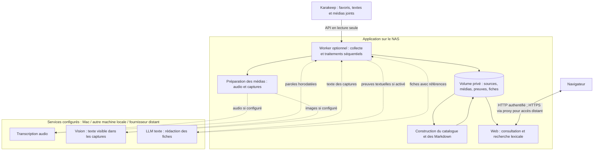

# Architecture de KaraRecall

État décrit le 6 novembre 2026. Ce document distingue le code livré des raccordements encore à réaliser. Les commandes de déploiement et les essais restants sont dans les guides [homelab](HOMELAB.md) et [pilote](PILOTE.md).

L’[étude d’exploitation et des coûts](ETUDE-EXPLOITATION.md) complète cette vue : quatre limites de retraitement/cache/couverture ont été reproduites sur des données fictives. Les corrections techniques sont maintenant décrites dans [P0.md](P0.md) ; les validations avec les services réels et sur le NAS restent à effectuer.

## 1. Ce qui fonctionne aujourd’hui

**Le Compose fournit l’application et son orchestration, pas les moteurs IA.** Il contient un service web et un worker optionnel. Aucun fournisseur, modèle téléchargé, serveur de transcription ou serveur de modèles n’y est installé automatiquement. Les connexions sont décrites dans `.env.example` puis renseignées dans le `.env` privé de chaque installation.

| Élément | État réel |
|---|---|
| POC local | Trois vidéos ont été transcrites sur le Mac avec faster-whisper et analysées par OCR Apple Vision. Les premières fiches ont été rédigées et enrichies avec l’assistant. |
| Consultation et recherche | Implémentées ; lisent le corpus conservé, sans appeler un modèle. |
| Collecte REST Karakeep | Implémentée et testée avec une API simulée ; à connecter au serveur réel du homelab. |
| Worker Docker : audio, vision, synthèse | Clients API implémentés ; tests avec services simulés et vidéo synthétique. Aucune inférence sur un fournisseur réel n’a été validée pour ce worker. |
| Installation neuve | Bibliothèque vide ; collecte et synthèse désactivées dans la configuration d’exemple, modèles audio/vision non renseignés. |
| NAS | Compose prêt à construire ; déploiement, ressources réelles et connexions restent à valider sur le matériel. |
| Enrichissement web et MCP | Pilote web DeepSeek configurable et adaptateur MCP local en lecture seule. |

Le fait que le POC ait produit une transcription ne signifie donc pas qu’un moteur de transcription est déjà fourni dans le Compose. Le script local existe ; son exposition comme service serait nécessaire pour un profil Mac. Le profil API proposé n’en dépend pas et peut être généré avec `scripts/setup_env.py --profile deepseek`.

Le [guide tous favoris et DeepSeek](IMPORT-ET-DEEPSEEK.md) décrit le profil retenu avec la clé déjà disponible, l’import initial depuis le web et les limites des fichiers sans texte. DeepSeek Flash est proposé pour texte et vision ; la transcription audio reste un service distinct à choisir.

## 2. Vue d’ensemble

Les flèches vers les moteurs IA sont facultatives. Une API est un moyen de communication : elle peut pointer vers le Mac sur le réseau local aussi bien que vers un fournisseur sur internet. « Appel API » ne signifie pas automatiquement « traitement dans le cloud ».

Le programme interroge Karakeep et télécharge ses pièces jointes. Il ne retourne pas télécharger la publication sur Instagram. Aucun outil présenté dans une vidéo n’est installé ou exécuté.

## 3. Les trois rôles IA

| Rôle | Entrée et sortie | Configuration | Ce que ce rôle ne couvre pas |
|---|---|---|---|
| Transcription, ou ASR | Son → paroles écrites, avec temps de début/fin lorsqu’ils sont fournis | `ASR_BASE_URL`, `ASR_MODEL`, `ASR_API_KEY` | Ne lit pas les mots affichés uniquement dans l’image. |
| Vision utilisée comme OCR | Captures → texte visible, conservé avec l’instant de la capture | `VISION_BASE_URL`, `VISION_MODEL`, `VISION_API_KEY` | Ne transcrit pas les paroles ; le code actuel lui demande du texte visible, pas une compréhension complète des actions de la vidéo. |
| Synthèse par LLM texte | Légende, texte de page, paroles/OCR disponibles → fiches d’outils sourcées | `LLM_ENABLED`, `LLM_BASE_URL`, `LLM_MODEL`, `LLM_API_KEY` | Ne navigue pas sur internet et ne vérifie pas les liens par lui-même. |

**L’audio n’exige pas un LLM de conversation ni un modèle vision.** Whisper est un modèle spécialisé de reconnaissance vocale. Un autre modèle acceptant l’audio peut aussi assurer ce rôle, à condition que son serveur fournisse le contrat attendu. Les rôles sont distincts ; ils peuvent partager un serveur, sans forcément partager un modèle.

Le worker sait appeler les services suivants :

- Audio : `POST <ASR_BASE_URL>/audio/transcriptions`, fichier WAV mono 16 kHz, modèle choisi, `response_format=verbose_json` et demande de granularité par segment. Les débuts/fins reçus sont contrôlés avant conservation. Si seul le texte est renvoyé, il est marqué avec une précision couvrant le média entier, sans fabriquer des horodatages détaillés.
- Vision : `POST <VISION_BASE_URL>/chat/completions` avec captures JPEG et demande de réponse JSON. Les images sont réduites à 1280 pixels maximum et échantillonnées à au plus 12 captures, espacées d’au moins 5 secondes par défaut. Les indices de confiance ne sont pas inventés.
- Synthèse : `POST <LLM_BASE_URL>/chat/completions` avec preuves textuelles dans un budget d’entrée de 24 000 caractères par défaut. Les sorties sont bornées en tokens, le raisonnement est réglable et les appels passent par un journal de budget. Le modèle propose des outils et des références ; le code vérifie la présence des références, refuse les fiches incomplètes et ne conserve les URL proposées que si elles figurent parmi les candidats détectés dans les preuves.

Un serveur simplement « compatible OpenAI » peut ne prendre en charge qu’une partie de ces routes ou paramètres. Chaque rôle doit être validé avec le modèle réellement choisi. Les références contrôlées empêchent les références inexistantes ; elles ne prouvent pas que la reformulation du modèle est fidèle. Les fiches automatiques restent marquées **À relire**.

## 4. Un favori, du début à la fiche

1. Si le profil `automation` et la synchronisation sont activés, le worker lit toutes les pages de favoris Karakeep. Il prépare l’import complet avant de publier les métadonnées locales. Par défaut tous les favoris sont retenus, y compris sites, articles, notes et fichiers. Des filtres URL/tags restent facultatifs. Le bouton d’import historique ignore ces filtres pour lire tout le catalogue sans téléchargement ni appel IA.
2. Les réponses brutes sont archivées par version, puis les sources sont dédupliquées par identifiant. La description et le texte de page sont des preuves distinctes ; le résumé IA de Karakeep n’est pas utilisé comme preuve des paroles ou des images.
3. Une file durable sélectionne les sources à traiter : trois par passage, toutes les quinze minutes par défaut. Les sources déjà traitées sont reconnues par leur empreinte de source/configuration.
4. Le worker télécharge les vidéos et les documents sans texte disponible si le téléchargement est activé. Les plafonds par défaut sont de 100 Mio et 300 secondes pour une vidéo, 20 Mio pour un document et 256 Mio d’espace libre réservé pendant les téléchargements.
5. PyAV décode le média sur le NAS. Le son est converti en WAV et les captures sont préparées sans modèle IA. Seules les étapes configurées appellent ensuite un moteur audio ou vision.
6. Le LLM texte, s’il est activé, rédige un résumé de lecture sourcé pour chaque favori, puis des fiches pour les seuls outils identifiés explicitement. Les résumés sont recherchables et exportés avec leurs preuves. Sans audio/vision, il peut produire une fiche à partir du texte source, mais cela ne constitue pas une analyse vidéo.
7. Le programme fige les preuves par contenu/provenance, conserve leurs captures, valide les références et reconstruit catalogue et Markdown dans une génération de travail. Seul le remplacement atomique de `data/current.json` rend cette génération visible. Les fiches éditoriales existantes sont préservées ; le worker remplace ses propres synthèses de la source traitée.
8. L’interface recharge le catalogue lors des requêtes s’il a changé ; actualiser l’écran permet d’afficher les nouvelles données.
9. Si la recherche web est activée, le worker relève et consulte des pages via DeepSeek après la publication. Les pistes et traces de lecture sont séparées des preuves d’origine. Une note documentaire publiée demande une revue. [Enrichissement web](RECHERCHE-WEB.md).

Le traitement des sources est séquentiel, mais audio et vision sont indépendants : un échec audio ne bloque pas un OCR réussi. La synthèse attend les étapes en échec. Les reprises sont bornées à trois tentatives automatiques par configuration, puis demandent une relance volontaire. Les anciennes fiches publiées restent consultables. Une tâche terminée signifie seulement que les étapes configurées ont fini, pas que toutes les modalités ont été analysées.

## 5. Où s’exécute la transcription ?

| Option | Situation et travail nécessaire | Conséquences |
|---|---|---|
| Script local faster-whisper sur le Mac | Déjà utilisé dans le POC : `scripts/transcribe.py`, modèle `small`, CPU avec calcul int8. Il écrit les résultats localement et ne fournit pas de serveur HTTP au NAS. | Pas d’envoi de l’audio à une API distante après téléchargement du modèle. Automatisation entre NAS et Mac à ajouter. |
| Service ASR sur le Mac / une machine locale | À déployer : moteur local derrière une API conforme au client actuel, ou adaptateur pour un autre contrat. Le Mac doit être allumé et joignable. | Données sur le réseau local ; mémoire et calcul du modèle consommés sur cette machine. |
| whisper.cpp sur le Mac | Alternative à évaluer : prise en charge d’Apple Silicon, Metal/Core ML et serveur HTTP. Sa route documentée est `/inference` ; ne pas supposer qu’elle remplace directement le contrat du worker. | Peut exploiter le matériel du Mac ; installation, adaptation et mesure réelles à effectuer. |
| Ollama avec modèle acceptant l’audio | La documentation actuelle décrit une route de transcription, mais indique que `timestamp_granularities` n’est pas pris en charge. Le client actuel demande ce paramètre : compatibilité à tester et adaptation éventuelle, sans présumer qu’un modèle texte accepte l’audio. | Peut regrouper plusieurs rôles sur le Mac si la version et les modèles les permettent. Aucun Ollama audio n’a été raccordé ni testé ici. |
| API ASR distante | Renseigner URL, modèle et clé d’un service conforme, puis tester une vidéo. | Indépendant du Mac ; audio envoyé au fournisseur, coût et règles de conservation propres au service. |
| Moteur directement sur le NAS | Non fourni dans le Compose actuel. Possibilité à mesurer selon CPU, RAM et petit modèle choisi. | Autonomie vis-à-vis du Mac, mais concurrence avec les autres services du NAS ; les 2–3 Go disponibles ne suffisent pas à garantir la faisabilité ou la vitesse. |

Orientation après l’[étude des coûts](ETUDE-EXPLOITATION.md), **pas encore déployée** : un premier profil API économique peut rendre le NAS autonome vis-à-vis du Mac, si la transmission des données convient. Le moteur local sur Mac reste une alternative à mesurer pour la confidentialité ou un besoin constaté ; le faible coût estimé des API ne suffit pas à rendre ce service local obligatoire. Aucun fournisseur n’est sélectionné par ce document.

## 6. Rôle de FFmpeg et réduction des appels IA

FFmpeg sert à décoder, convertir, extraire des pistes, découper un média ou produire des captures. Ces opérations n’exigent pas de modèle IA. Le worker utilise déjà les bibliothèques FFmpeg à travers PyAV ; il ne lance pas le programme `ffmpeg` et n’embarque pas son filtre Whisper.

Pour reconnaître des paroles nouvelles, un moteur de reconnaissance vocale reste nécessaire. **FFmpeg dispose aussi d’un filtre `whisper`**, qui s’appuie sur la bibliothèque whisper.cpp et sur un modèle téléchargé ; il faut une compilation avec `--enable-whisper`. Cette option permet une transcription locale, mais elle utilise toujours un modèle IA. Son intégration à KaraRecall reste à réaliser et la présence du filtre ne doit pas être supposée dans toute installation de FFmpeg.

Les transcriptions et OCR sont réutilisés lorsque le média, le modèle et les paramètres de cache correspondent. Chercher ou ouvrir une fiche ne relance aucun modèle. Avec `REUSE_SUBTITLES`, le worker conserve une piste textuelle exploitable avec ses horodatages et peut éviter l’appel ASR. Le mode optionnel `VISION_SAMPLE_MODE=changes` sélectionne localement les changements visuels avec le même plafond d’images envoyées.

Poppler extrait le texte PDF incorporé. Sur activation explicite, le service vision peut lire des aperçus JPEG des pages sans texte. Le traitement optionnel des documents longs résume des passages et conserve leurs références vers le texte original ainsi qu’une mesure de couverture. [Paramètres](HOMELAB.md#pdf-et-images).

Le format produit par FFmpeg/Whisper devrait être converti vers les preuves JSON de KaraRecall, avec temps, statut et empreinte média. Remplacer un appel distant par un moteur local nécessite donc un raccordement explicite, pas seulement l’ajout du mot « FFmpeg » dans la configuration.

## 7. Consultation et recherche

Le navigateur consulte le corpus en lecture seule ; une commande authentifiée et protégée contre les requêtes intersites peut demander un import global. Elle écrit une demande locale, exécutée par le worker, sans modification de Karakeep. Le service web lit le catalogue JSON, classe les résultats et sert les médias/images autorisés. La recherche examine les titres, descriptions, usages, preuves citées et textes des sources, y compris les transcriptions et l’OCR. Elle normalise les accents et rapproche certaines fautes d’orthographe. **Elle n’est pas limitée à une correspondance de phrase exacte, mais elle n’est pas sémantique** et ne fait appel à aucun LLM ni embedding.

Une source expose sa transcription à côté de la vidéo. Les passages disponibles sont cliquables pour naviguer à l’instant cité. Le panneau permet de rechercher et surligner des mots. Les résultats globaux peuvent ouvrir directement la preuve horodatée. Les preuves PDF sont repérées par page.

Les listes Sources et Traitements chargent 24 entrées par requête. L’adaptateur MCP est un processus local stdio séparé qui appelle l’API web authentifiée en lecture seule. Les outils renvoient les références et l’URL source. [Guide MCP](MCP.md).

Le bouton de contexte fournit un texte à copier dans un assistant ; il ne transmet rien automatiquement. L’adaptateur MCP local réutilise les routes de lecture. Les routes de lecture existantes sont détaillées dans [WEB.md](WEB.md).

## 8. Données, configuration et disponibilité

| Emplacement | Contenu et responsabilité |
|---|---|
| Dépôt Git privé | Code, documentation, exemple de configuration et tests synthétiques. Aucun corpus utilisateur ni secret. |
| `.env` sur l’hôte | Identifiants web, adresses, modèles, clés et activation des services. Compose transmet explicitement les variables requises à chaque conteneur ; le web ne reçoit pas les clés IA/Karakeep. Modifier ce fichier puis recréer les services pour appliquer les changements. |
| Volume Docker du NAS | Sources normalisées, réponses brutes versionnées, médias, extractions et fiches ; données privées à sauvegarder séparément. |
| `data/current.json`, `data/generations/…` | Pointeur vers le catalogue et les Markdown d’une génération validée ; les chemins du catalogue sont relatifs à cette génération. |
| `data/work/…` et `data/usage.sqlite` | Cache de travail reprenable et journal comptable des requêtes, hors générations publiées. |
| `data/worker.sqlite` | État durable des tâches, erreurs contrôlées et délais de reprise. Ce n’est pas un historique de conversation avec un modèle. |
| `data/index.sqlite` | Index dérivé régénérable ; la recherche web actuelle parcourt le catalogue JSON. |
| Serveur de modèles | Modèles et ressources de calcul indépendants du volume applicatif ; peut être local ou distant. |

Les preuves brutes, synthèses et vérifications externes sont séparées. Une extraction associée à une autre empreinte média est refusée. Les références des fiches utilisent des preuves par contenu et provenance. Le lecteur suit une génération complète par requête. Les remplacements vidéo restent bloqués pour préserver les anciennes citations. Les PDF et images portant un nouvel identifiant sont archivés séparément. Les favoris absents restent dans le catalogue local. [Politique de conservation](EXPLOITATION-LONG-TERME.md#conservation).

Le web est limité à 384 Mio et le worker à 768 Mio dans Compose, sans moteur de modèle chargé. La bibliothèque existante reste consultable si le Mac est éteint ou si une API IA tombe en panne ; les nouveaux traitements qui en dépendent échouent puis reprennent plus tard. Le volume et le `.env` doivent être sauvegardés. Pour un accès distant, HTTPS via reverse proxy ou VPN ; l’application utilise HTTP Basic, avec un compte personnel partagé.

## 9. Carte du code et décisions restantes

| Fichier | Responsabilité |
|---|---|
| `compose.yaml`, `Dockerfile` | Services web/worker, volume, réseau et limites de ressources. |
| `settings.py`, `.env.example` | Paramètres, validations et activation des étapes. |
| `integrations.py` | Lecture REST Karakeep et client de conversation compatible OpenAI. |
| `controls.py` | File durable des demandes manuelles d’import du catalogue, sans inférence. |
| `worker.py` | Synchronisation, file de tâches, reprises, synthèse et publication. |
| `publication.py`, `usage.py` | Générations, preuves immuables et réservations/consommations IA persistantes. |
| `worker_media.py` | Préparation audio/images et clients ASR/vision du worker Docker. |
| `digests.py`, `digest_writer.py`, `digest_delivery.py` | Éditions persistantes, relecture, exports, planification et diffusion configurée. |
| `worker_documents.py`, `reading.py` | Extraction PDF/image et synthèses par passages. |
| `web_research.py`, `editorial.py` | Recherche web séparée, revue humaine et conservation des révisions. |
| `kararecall_mcp.py` | Adaptateur stdio vers l’API web en lecture seule. |
| `kararecall.py` | Preuves, validation des fiches, catalogue, Markdown et recherche. |
| `web_server.py`, `web/` | Interface, authentification, API de lecture et médias. |
| `scripts/transcribe.py`, `scripts/process.py`, `scripts/ocr.swift` | Pipeline local historique : faster-whisper et OCR Apple Vision sur macOS, distinct du worker Docker. |

Les essais restants portent sur les services réels, les modèles, le NAS et l’usage du MCP depuis un assistant. Un raccordement audio local et une recherche hybride dépendent des résultats du pilote. [Backlog](../backlog.md).

## Références techniques

Documentation officielle consultée le 5 novembre 2026. Les capacités des outils ci-dessous sont documentées ; leurs performances sur ce NAS et ce Mac ne sont pas déduites de ces pages.

- [faster-whisper 1.2.1 : exécution et exemples CPU](https://github.com/SYSTRAN/faster-whisper/tree/v1.2.1).
- [whisper.cpp : exécution locale et prise en charge Apple Silicon](https://github.com/ggml-org/whisper.cpp) ; [serveur HTTP et route d’inférence](https://github.com/ggml-org/whisper.cpp/blob/master/examples/server/README.md).
- [FFmpeg : filtre Whisper, dépendances et formats de transcription](https://ffmpeg.org/ffmpeg-filters.html#whisper).
- [Ollama : compatibilité texte, vision et audio](https://docs.ollama.com/api/openai-compatibility).
- [Contrat de transcription OpenAI : formats et horodatages](https://developers.openai.com/api/reference/resources/audio/subresources/transcriptions/methods/create).
- [Contrat REST Karakeep](https://github.com/karakeep-app/karakeep/blob/main/packages/open-api/karakeep-openapi-spec.json).

## Bulletins de veille

Le web prépare et relit les éditions dans `data/digests/`, sur le volume partagé. Le worker prépare les intervalles échus et traite les demandes de diffusion validées. Le modèle texte rédige les articles à partir des preuves et des fiches existantes, avec des références par paragraphe et le même journal de budget. Une première édition exploite l’historique, puis les rythmes configurés prennent le relais. Les images et les extraits sont conservés avec l’édition. Le mail et le webhook utilisent leurs propres paramètres privés, transmis uniquement au worker. [Guide et configuration](VEILLE.md).
