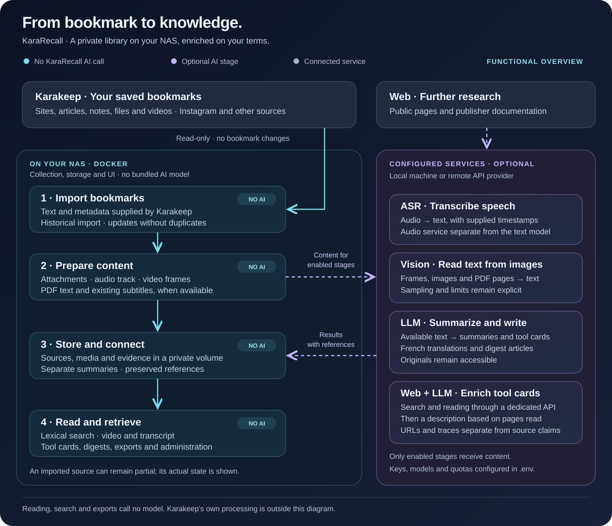

<p align="center"></p>
<h1 align="center">KaraRecall</h1>
<p align="center"><strong>Find your discoveries. Understand their value. Keep the thread.</strong><br />Your personal library, built from all your Karakeep bookmarks.</p>
<p align="center">Self-hosted on your NAS · Docker Compose · Configurable AI · Portable evidence</p>
<p align="center"><a href="../../README.md">🇫🇷 Français</a> · <strong>🇬🇧 English</strong></p>
<p align="center"><a href="installation.md">Install</a> · <a href="functional-architecture.md">How it works</a> · <a href="docker-images.md">Update</a> · <a href="#documentation">Documentation</a> · <a href="backlog.md">Backlog</a></p>
<p align="center"><a href="https://github.com/Nello10110/kararecall/actions/workflows/ci.yml"></a></p>

## Turn bookmarks into a useful library

Karakeep saves an article, a website or a video. KaraRecall helps you find it again, understand what it offers and return to its sources. It keeps a private library on your NAS, with optional summaries, translations, video transcripts and text extracted from images. Reading and searching remain available when AI services are offline.

**All bookmarks are included by default:** websites, articles, notes, files, PDFs, images and videos, including Instagram reels. Karakeep is strictly read-only: KaraRecall never changes, tags or deletes your bookmarks.

| What you want | What KaraRecall provides |
|---|---|
| Find a discovery | Lexical search across titles, source text, summaries, transcripts and recognized image text |
| Understand a tool | Description, usefulness, operation, limitations and links, with evidence references |
| Return to a passage | Video beside its transcript, clickable timestamps, captured frames and PDF page references |
| Keep up with discoveries | Illustrated weekly/monthly articles, with optional email, private RSS and webhook delivery |
| Continue with an assistant | Markdown exports, evidence-backed context and a read-only MCP adapter |
| Run the application | Dashboard, processing queue, AI quotas, diagnostics, pause and retry controls |

The glass interface supports light/dark themes and mobile navigation. **This English documentation does not change the application language:** the interface and generated editorial content currently remain French. Original source text is preserved separately from French translations.

The **Karakeep synchronization** panel compares accessible upstream bookmarks with local sources, shows missing records and provides separate catalogue check/import actions without starting AI analysis. [Counters and controls](web-and-api.md#karakeep-synchronization-060).

## How it works



1. **Import:** read Karakeep metadata and available text. The historical import uses no AI and deduplicates by bookmark ID.
2. **Prepare:** download permitted attachments from Karakeep, extract audio and frames, read embedded PDF text and reuse suitable subtitle tracks.
3. **Enrich when configured:** separate audio, vision and text services provide recognition and editorial output. Optional web research supplies pages and reading traces for tool descriptions.
4. **Keep and use:** store sources, media, evidence and summaries in a private persistent volume. Search, read, review and export through your browser.

| Stage | AI use by KaraRecall |
|---|---|
| Catalogue import, deduplication and media preparation | None |
| New speech recognition | A configured ASR service, such as Whisper |
| Reading text from images/PDF previews | A configured vision model |
| Summaries, translations, tool cards and digest writing | A configured text model |
| Web enrichment | Search/fetch services plus a text model using the retrieved pages |
| Search, reading and exports | None; previously stored content is used |

Search is **lexical**, with accent normalization and approximate spelling. There are no embeddings or semantic search calls. AI services are separate from the Compose stack and may run locally or remotely. Karakeep's own AI processing is independent of KaraRecall.

Every source has a preview: a local image, a video frame, an existing evidence image or a clearly marked generic cover. Missing text is reported honestly rather than presented as an analyzed document.

## Quick start on a NAS

You need Docker Compose v2, a reachable Karakeep server and its API key. Public images support Linux AMD64 and ARM64; no GitHub account or NAS build is required.

```sh
git clone https://github.com/Nello10110/kararecall.git
cd kararecall
python3 scripts/setup_env.py --profile deepseek
```

Edit the existing lines in your private `.env`:

```dotenv
COMPOSE_PROFILES=automation
KARARECALL_BIND_ADDRESS=0.0.0.0
KARAKEEP_BASE_URL='https://karakeep.example.net'
KARAKEEP_API_KEY='REPLACE_WITH_YOUR_KARAKEEP_KEY'
SYNC_ENABLED=false
LLM_ENABLED=false
KARAKEEP_URL_FILTER=
KARAKEEP_TAG_FILTER=
```

```sh
docker compose up -d
```

Open `http://NAS_IP:8765`, sign in with the generated `.env` credentials and select **Activité → Importer tout l’historique**. For a Mac-only trial, retain `127.0.0.1` as the bind address. The first import needs no AI. Enable models and periodic synchronization after checking one source. The DeepSeek profile prepares text/vision settings; speech recognition requires a separate audio service.

**[Follow the installation guide](installation.md)** for the no-Python setup method, AI activation and troubleshooting. Use a VPN or HTTPS reverse proxy for remote access.

## Update with latest

```sh
docker compose --profile automation pull web worker
docker compose --profile automation up -d --no-deps web worker
```

Both images are published after tests pass. `latest` is fetched on deployment; an already running container does not update itself. Keep your existing volume and `.env`. Commit tags can pin a tested pair. [Docker and Dockhand guide](docker-images.md).

## Data, limits and validation

The persistent volume contains private JSON, media, evidence, Markdown and digests. A fresh installation starts empty. Original text, personal notes, recognition output, translations, summaries and external verification remain separate, with immutable references and previous generations. Remote models receive only the content for their configured stages. The application has caches, bounded retries and persistent quotas.

Default video limits are 100 MiB and five minutes; vision samples at most 12 frames at least five seconds apart. Short text can be missed. The default accounting budget is USD 2/month, separate from provider billing and Karakeep's own calls. AI citations prove that a passage exists, not that the model paraphrased it correctly. The application uses a shared account, without multi-user roles. A volume is persistence, not an external backup.

Synthetic tests and container checks pass; real provider quality, NAS load, delivery and external restore remain pilot tasks. [Pilot](pilot.md) · [Remaining work](backlog.md).

## Documentation

| Topic | English guide |
|---|---|
| Installation and first import | [Installation](installation.md) |
| Functional overview and AI boundaries | [Functional architecture](functional-architecture.md) |
| Components, contracts and portable data | [Technical architecture](architecture.md) |
| Images, latest, Dockhand and local builds | [Docker images](docker-images.md) |
| NAS configuration, network and backup | [Homelab](homelab.md) |
| Importing bookmarks and configuring DeepSeek | [Import and DeepSeek](import-and-deepseek.md) |
| Screens, administration and API | [UX and administration](ux-and-administration.md) · [Web and API](web-and-api.md) |
| Weekly/monthly articles and delivery | [Digests](digests.md) |
| Web research and attribution | [Web enrichment](web-enrichment.md) |
| Assistant connection | [Read-only MCP](mcp.md) |
| Validation, costs and measurements | [Pilot](pilot.md) · [Reliability foundation](reliability.md) |
| Supported formats and partial processing | [Formats and coverage](formats-and-coverage.md) |
| Previous generations and restoration | [Recovery and generations](recovery-and-generations.md) |
| Choices, estimates and future work | [Operations study](operations-study.md) · [Long-term operations](long-term-operations.md) · [Backlog](backlog.md) |
| Repository layout and development commands | [Repository guide](repository.md) |

## Development

Python 3.12 in the images; HTML/CSS/JavaScript without a frontend build. Web and optional worker limits are 384 MiB and 768 MiB, excluding model servers.

```sh
PYTHONPYCACHEPREFIX=.build/pycache python3 -m unittest discover -s tests -v
python3 scripts/check_container.py
docker compose -f compose.yaml -f deploy/compose.build.yaml up -d --build
```

The container check builds local code and removes only its own test resources. Legacy macOS processing is separate from the Docker worker. SQLite is derived or operational according to its role; portable JSON/Markdown remain usable without a particular AI provider. AFFiNE and Wiki.js can receive manual exports; no automatic synchronization connector is included.
