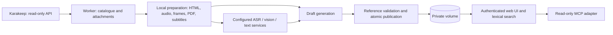

# KaraRecall technical architecture

[🇫🇷 Français](../ARCHITECTURE.md) · [🇬🇧 English](architecture.md)

The application is a private, portable library built from all Karakeep bookmark types. Docker supplies a web server and an optional worker; the initial macOS POC is a separate path. AI endpoints remain external to the stack. The target NAS has roughly 2–3 GiB available for the application, so models are not loaded there by default.

## Components and publication flow

Catalogue import, preparation, publication, reading and search make no AI calls. ASR, vision, editorial generation and optional web enrichment are configured stages. [Functional diagram](functional-architecture.md).

1. The worker reads every Karakeep page before publishing a catalogue update. Default filters include every bookmark type; optional filters apply to periodic processing, while historical import reads all history.
2. Raw API snapshots are versioned and source IDs deduplicate records. Caption, page, personal note, transcript, OCR and editorial output remain distinct. Karakeep's unverified AI summary is not video evidence.
3. Durable SQLite jobs select a bounded batch, default three every 900 seconds. Source/configuration fingerprints identify unchanged successful jobs. Changing a key alone does not invalidate successful inference caches.
4. Permitted attachments are downloaded with bounds and a disk reserve. Software decoding, text subtitles and PDF extraction prepare useful content locally.
5. Separate configured roles recognize speech/images and generate reading summaries/tool cards. A source can have a summary without an identified tool. Incomplete input cannot become a claim of exhaustive media analysis.
6. A draft generation freezes evidence identities and validates citations. An atomic replacement of `data/current.json` selects the complete new publication. Failed publication leaves the prior coherent library selected.
7. The web server reloads a changed generation and serves only authorized media/proofs. Editing uses authentication, CSRF protection, a shared writer lock and revision conflict checks.

Separate HTML assets and the Karakeep readable-content route can supply missing site text; requests are bounded and their snapshots/hashes accompany page evidence. PDF attachments to links are extracted separately from their web page. Previews use local Karakeep images, video frames, evidence or a generic cover, independently of AI quotas. Animated image recognition covers only the first frame. Unknown formats do not trigger text inference. [Format matrix](formats-and-coverage.md).

## AI role contracts

| Role | Contract | Limits |
|---|---|---|
| ASR | `POST <ASR_BASE_URL>/audio/transcriptions`, mono 16 kHz WAV multipart, model and `verbose_json`, segment timing when supported | Validate received timing; whole-media precision if only text is returned; no image recognition |
| Vision OCR | `POST <VISION_BASE_URL>/chat/completions`, base64 JPEG `image_url`, JSON text output | At most 12 sampled frames by default, minimum five seconds, maximum 1280-pixel input previews; no invented confidence values |
| Text synthesis | `POST <LLM_BASE_URL>/chat/completions`, selected text evidence and IDs | Default 24,000 input characters, configured output cap; valid references and only source-supported URLs; no implicit browser search |

An OpenAI-compatible label does not prove every parameter is accepted. Provider/model combinations need real tests. Official DeepSeek endpoints use JSON object mode. Invalid/blank OCR may be retried once; refusal, truncation and HTTP errors are not covered by that retry. Each request passes through usage accounting.

## Where transcription runs

The POC used local faster-whisper `small` on a Mac CPU with int8. Its script writes local files; it is not an HTTP service for the NAS. A local Mac ASR service needs a reachable compatible endpoint or adapter. whisper.cpp is a possible Apple Silicon option, but its `/inference` route is not assumed to match the current client. A text-only Ollama server is not an ASR endpoint, and audio/timestamp compatibility must be tested for the selected version/model. A remote compatible service makes processing independent of the Mac while receiving the audio. Running models directly on the NAS is not included or performance-qualified.

PyAV uses FFmpeg libraries for decoding/conversion without a standalone FFmpeg executable. FFmpeg alone does not recognize speech. A build with its Whisper filter still uses a downloaded AI model and needs an adapter to KaraRecall's evidence format; that integration is not supplied. Subtitle reuse, image-change selection and valid extraction caches can reduce paid calls without claiming recognition that did not occur.

## Data, evidence and attribution

| Location | Role |
|---|---|
| Private `data/raw/api/` | Versioned read-only Karakeep responses and supplementary page snapshots |
| `data/current.json` | Pointer to the selected complete generation |
| Generation `data/sources.json`, `entities.json`, `catalog.json` | Portable sources, tool cards and derived catalogue |
| Generation media/documents/evidence/previews | Originals and immutable visual references |
| `vault/` | Generated Markdown, rebuilt rather than edited directly |
| `data/work/`, `data/usage.sqlite`, `data/worker.sqlite` | Resumable caches and operational/accounting state outside published generations |
| `data/digests/` | Digest editions, copied images, revisions and delivery receipts |

Claims cite `BOOKMARK_ID#EVIDENCE_ID`. `source_claim` means according to the source; `documented` requires a publisher URL and reading trace; `verified` additionally requires external support; `hypothesis` remains explicitly tentative. A 404 establishes only that reading result at its date. Documentary reading does not prove product performance. Original recognition mistakes remain in raw evidence; corrections need explicit support. Translations are derived views retaining the original IDs/timing.

Published generations are immutable. Review operates in a new draft, preserves history and serializes with worker writes. Media hashes prevent stale extraction from being accepted for another file. Old root JSON may predate the selected generation. SQLite is not the sole portable record of the library.

## Search, availability and code map

Search is lexical, accent-normalized and spelling-tolerant, over local source text, cited tool context, summaries and translations. Its score is relevance, not truth. No search-triggered model/embedding call occurs. Stored results remain usable when an inference endpoint is unavailable. Authentication covers pages, APIs and media; arbitrary private files are not exposed.

Source code is under `kararecall/`: `core.py` handles evidence/catalogue/search, `worker.py` orchestration, `worker_media.py` and `worker_documents.py` extraction, `publication.py` generation handling, `usage.py` accounting, `controls.py` durable commands, `web_server.py` HTTP, `overview.py`/`content_support.py` diagnostics, `mcp.py` assistant access and digest modules publishing/delivery. `web/` contains static UI assets. [Repository guide](repository.md).

Remaining validation concerns real provider behavior, NAS performance, reverse proxy/video playback, external restore and assistant/voice use. Long-media segmentation and hybrid search depend on measured pilot needs. Existing completed synthetic tests do not establish those real-world results. [Reliability](reliability.md) · [Operations study](operations-study.md) · [Backlog](backlog.md).
