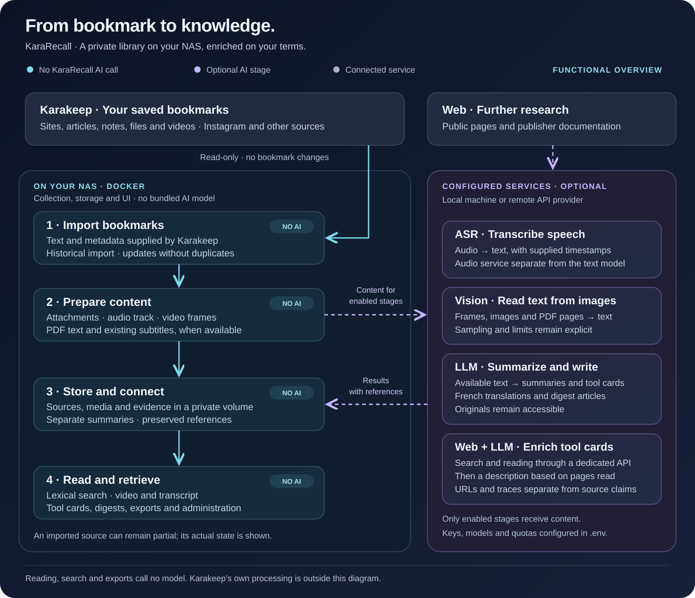

# Functional architecture

[🇫🇷 Français](../ARCHITECTURE-FONCTIONNELLE.md) · [🇬🇧 English](functional-architecture.md)

KaraRecall turns content already saved in Karakeep into a searchable private library. The NAS handles collection, storage and the interface; model services are configured separately.

Blue means **no KaraRecall AI call**, purple means an optional AI step, and gray means a connected service. Labels also identify these roles. The editable SVG uses no external images or remote fonts.

## 1. Import saved content

Karakeep is the entry point for sites, articles, notes, files and videos. Read-only API access preserves the content accessible to the configured key without modifying bookmarks or returning to Instagram. Historical import reads text and metadata without inference or media downloads. The same ID updates an existing source. Periodic analysis is separate from this import. Karakeep's own previous AI work is outside the diagram.

## 2. Prepare content locally

During processing, the worker can download attachments from Karakeep, prepare audio and frames, reuse text subtitle tracks and extract embedded PDF text. These operations do not require AI. Downloaded content is not automatically analyzed: scanned pages and visible image text require an additional recognition stage. Size, duration, pages and sampling limits remain visible.

## 3. Use configured services

| Role | Sent to service | Returned | Main configuration |
|---|---|---|---|
| ASR | Prepared audio | Speech text and supplied timing | `ASR_BASE_URL`, `ASR_MODEL`, `ASR_API_KEY` |
| Vision | Frames, images or PDF page previews | Recognized text associated with image/time/page | Vision endpoint/model/key and document OCR options |
| Text LLM | Available text and evidence IDs | Summaries, translations, tool cards and digest prose | `LLM_ENABLED` and text endpoint/model/key |
| Web enrichment | Tool name and candidate public addresses; fetched pages to the LLM | Links, reading traces and attributed descriptions | Explicit command or configured periodic research |

ASR is specialized speech recognition. A text or vision model does not replace it automatically. Current vision processing reads text from sampled images; it is not exhaustive video understanding. Local services must be reachable and running; remote services receive the configured stage's content. The Compose stack contains no model server. Cache reuse and persistent limits apply independently to each role.

## 4. Store, link and publish

The worker prepares a coherent generation, validates references and publishes it atomically. Private storage keeps sources, originals, evidence, editorial output and old citations. Personal notes, recognized text, original content, translation and external verification are distinct. A valid citation establishes that the passage exists, not that the model's claim is accurate.

## 5. Read and search without models

The web server reads the local catalogue, protects APIs/media with authentication and returns lexical results with source references. Search, reading, proof navigation, Markdown export and copying context do not invoke models. MCP provides bounded read-only access for an assistant. The assistant must respect attribution and absent information.

## 6. Prepare and deliver digests

Selection, scheduling, rendering and delivery are application logic. Configured text generation writes illustrated weekly/monthly articles from saved evidence. Email/webhook delivery requires explicit channel configuration; RSS stays private. Rendering and reading existing editions do not rerun the LLM.

## Administration boundaries

The operator configures endpoints, credentials, model roles, quotas, schedules, access and backups. Stage status, actual coverage, provider connectivity and accounting are exposed separately. Missing inputs and unsupported formats remain explicit. [Technical architecture](architecture.md) · [Homelab](homelab.md) · [Pilot](pilot.md) · [Backlog](backlog.md).
